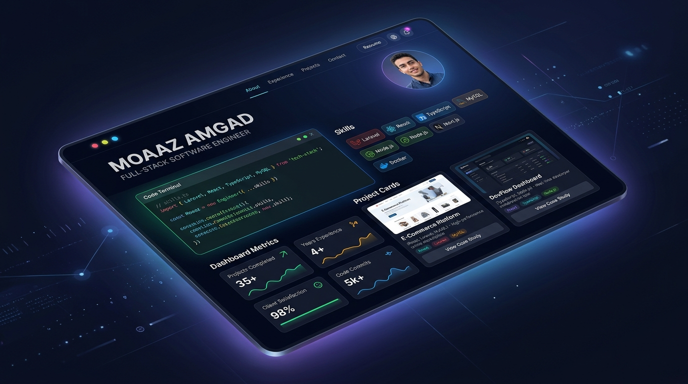

# Moaaz Amgad — Official Portfolio

<div align="center">



# Moaaz Amgad
### Full-Stack Software Engineer & System Architect

[](https://moaaz-amgad.github.io/portfolio/)
[](https://www.linkedin.com/in/moaaz-amgad/)
[](https://github.com/moaaz-amgad)

</div>

---

## 🌟 Overview

Welcome to the official repository of my personal portfolio website. Built from scratch without templates or third-party themes, this portfolio demonstrates production-level frontend engineering, interactive animations, and responsive system design.

🔗 **Live Website:** [https://moaaz-amgad.github.io/portfolio/](https://moaaz-amgad.github.io/portfolio/)

---

## 🛠️ Core Technology Stack

- **Frontend Core:** HTML5, Modern Vanilla CSS3, JavaScript (ES6+)
- **Styling & Components:** Tailwind CSS (utility architecture), Font Awesome 6
- **Graphics & Motion:** HTML5 Canvas API (interactive particle matrix & ambient animations)
- **Deployment:** GitHub Pages with automated CDN delivery

---

## 🏗️ Featured Engineering Projects

### 1. [Trovo — AI-Powered Digital Wellness Platform](https://github.com/moaaz-amgad/trovo)
- Sole backend API architect for a cross-functional digital health platform.
- Behavioral telemetry ingestion, neuro-cognitive assessment engines, and secure RBAC with Laravel Sanctum.
- **Stack:** Laravel 12, PHP 8.2, MySQL, RESTful APIs, XGBoost AI integration.

### 2. [HR & Payroll Management System](https://github.com/moaaz-amgad/hr-payroll-system)
- Full-stack enterprise workforce system supporting multi-branch governance.
- Automated running-balance ledgers, double-entry financial accounting, and Egyptian labor tax compliance.
- **Stack:** Laravel 12, React 18, TypeScript, Ant Design, MySQL, DomPDF, Chart.js.

### 3. [Dermatology Clinic EMR](https://github.com/moaaz-amgad/dermatology-clinic-emr)
- Electronic medical records system tailored for clinical dermatology workflows.
- Fitzpatrick skin typing, session tracking counters, before/after photo galleries, and automated PDF prescriptions.
- **Stack:** Laravel 12, Bootstrap 5.3, Alpine.js, MySQL, DomPDF.

---

## 💻 Local Preview

To run or inspect this portfolio locally:

```bash
# Clone the repository
git clone https://github.com/moaaz-amgad/portfolio.git

# Navigate into the folder
cd portfolio

# Open index.html in your preferred browser
start index.html
```

---

## 📬 Contact & Connect

- **Email:** [moaazamgad83@gmail.com](mailto:moaazamgad83@gmail.com)
- **LinkedIn:** [linkedin.com/in/moaaz-amgad](https://www.linkedin.com/in/moaaz-amgad/)
- **GitHub:** [github.com/moaaz-amgad](https://github.com/moaaz-amgad)

---

<div align="center">
<sub>Designed & Engineered with ❤️ by Moaaz Amgad © 2026. All rights reserved.</sub>
</div>
